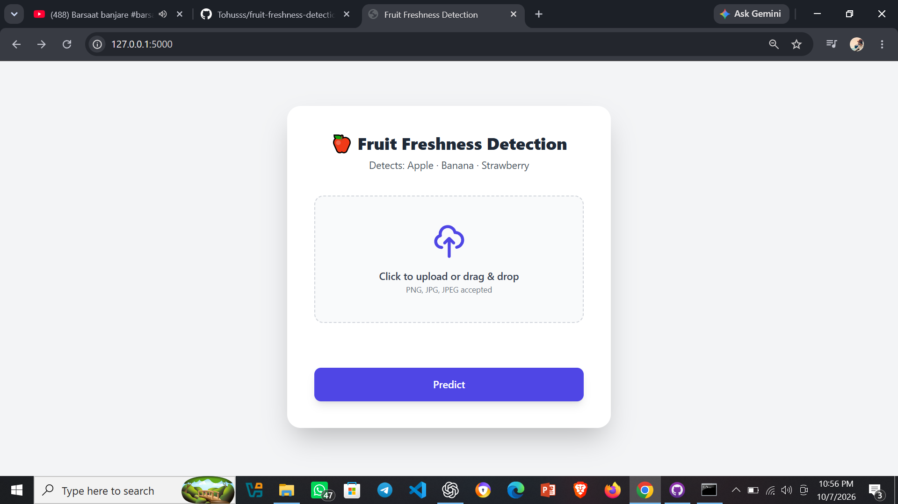
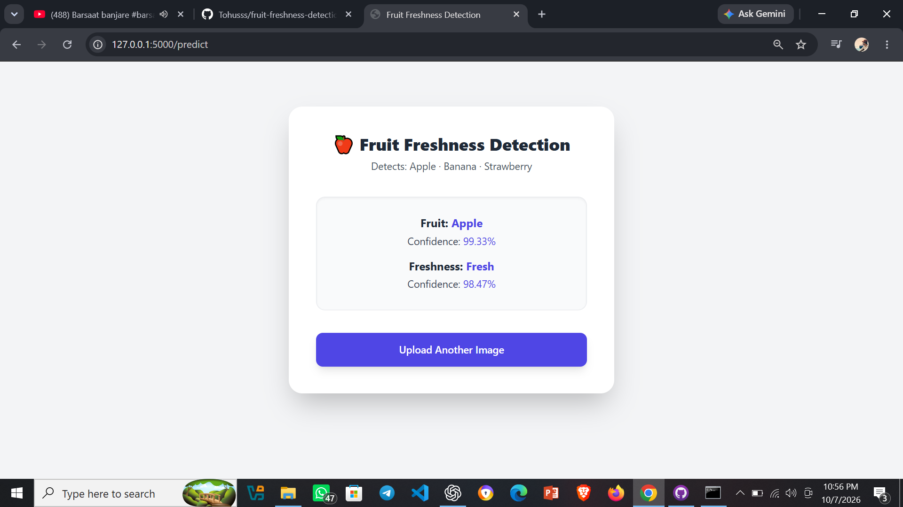

# Fruit Freshness Detection System

An image-based machine learning application for automated fruit freshness detection and classification.

## Features

- Detects fruit freshness from images
- Classifies fruit condition using deep learning
- Uses a ResNet18-based model
- Provides a simple web interface
- Displays prediction results clearly

## Technologies Used

- Python
- PyTorch
- ResNet18
- Flask
- HTML
- CSS
- Computer Vision
- Machine Learning

## Project Structure

- `src/` – source code for dataset handling, model logic, and prediction
- `web/` – web interface files
- `app.py` – main application entry point
- `models/` – trained model weights
- `data/` – sample dataset images
- `screenshots/` – application and prediction screenshots
- `requirements.txt` – required Python dependencies

## How to Run

### 1. Clone the Repository

```bash
git clone https://github.com/Tohusss/fruit-freshness-detection.git
```

### 2. Open the Project Folder

```bash
cd fruit-freshness-detection
```

### 3. Install Dependencies

```bash
pip install -r requirements.txt
```

### 4. Run the Application

```bash
python app.py
```

## Screenshots

### Application Interface



### Prediction Result



## Model

The project uses a ResNet18-based deep learning model for image classification and fruit freshness prediction.

## Future Improvements

- Improve prediction accuracy
- Add support for more fruit categories
- Improve the web interface
- Add real-time image prediction support
- Deploy the application online

## Author

**Tauhidul Islam**
